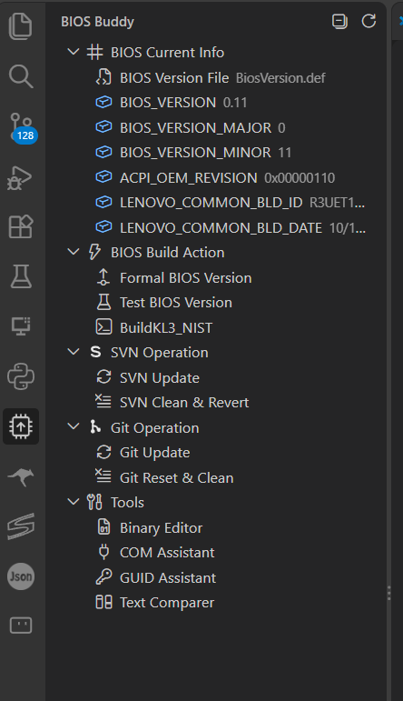
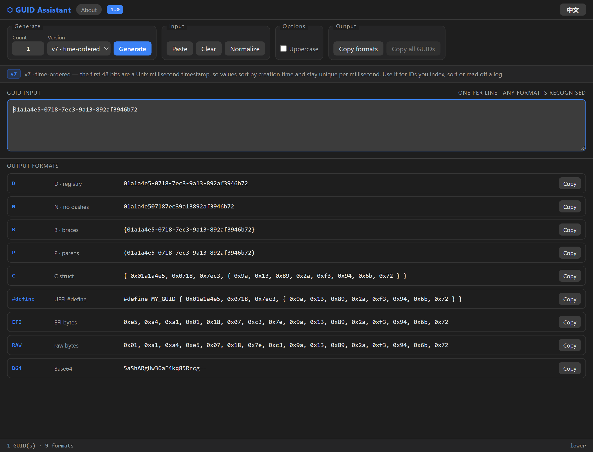
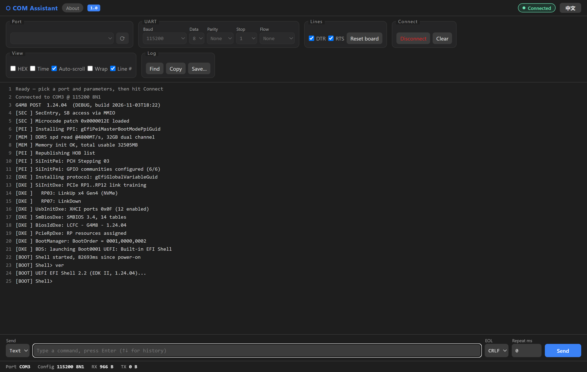
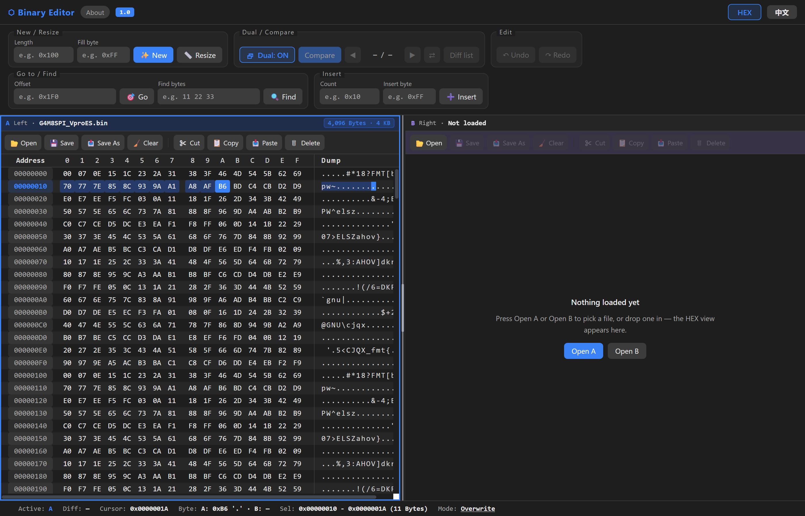
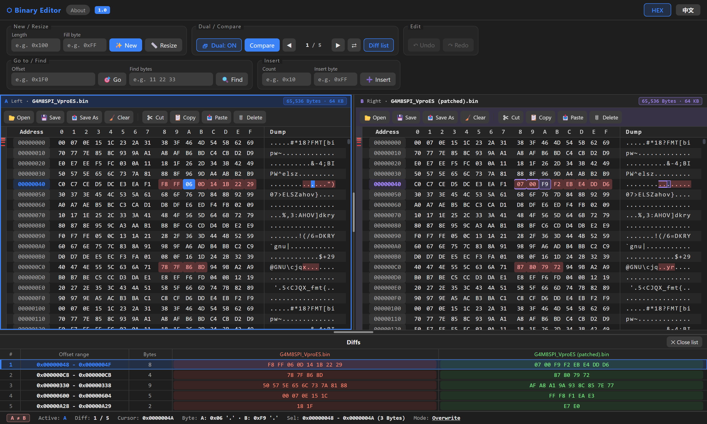
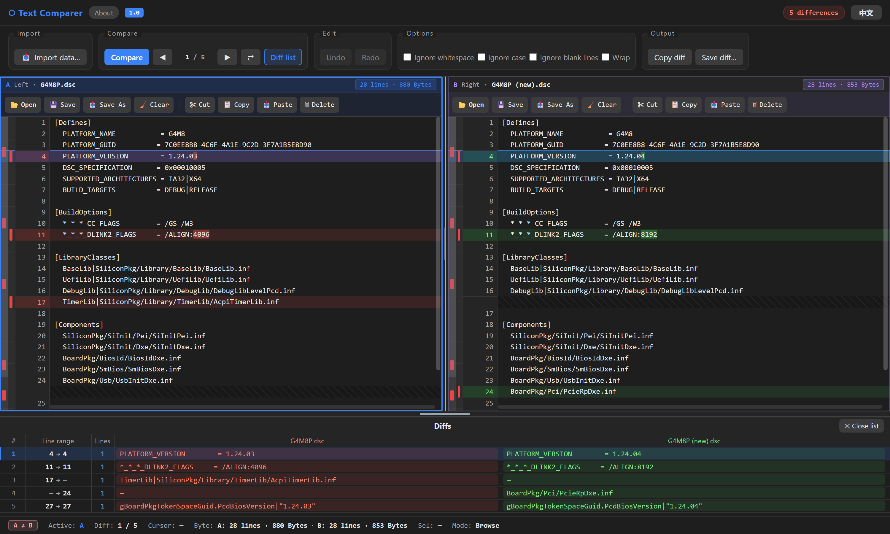

# BIOS Buddy 使用指南

- V 0.1.4

---

## 1. 侧边栏

点左边活动栏的 BIOS Buddy 图标就能打开。

一共五个分组：

| 分组 | 里面是什么 |
| --- | --- |
| **BIOS Current Info** | 第一行选版本文件（齿轮），下面是从文件里读出来的字段和当前值 |
| **BIOS Build Action** | Formal / Test 两条改版本的行，加若干条编译行 |
| **SVN Operation** | 默认 Update 和 Clean & Revert |
| **Git Operation** | 默认 Update 和 Reset & Clean |
| **Tools** | 四个工具，点一下就开一个面板 |

视图标题栏右边有三个按钮：

| 按钮 | 作用 |
| --- | --- |
| `⊟` / `⊞` | 全部折叠 / 展开 |
| `⟳` | 刷新。改过 `.def`、或者外部动过仓库，点一下重新读 |
| `↺` | 恢复默认行顺序。只恢复顺序，自己加的行、改过的命令都还在 |

所有行都能拖动排序，顺序存在 `.vscode/settings.json` 里。

## 2. 改版本和编译

- **Formal BIOS Version** / **Test BIOS Version**：按各自的字段集合改版本号。改之前会先弹一个 diff 让你确认，确认后才写文件。这两行不会触发编译。
- **编译行**：每条绑一个脚本，点一下就开始编译。脚本名就是行名。
- 鼠标移到 **BIOS Build Action** 标题上会出现 `＋`，可以再加一条编译行，或者右键某行改脚本、改参数、重命名。

## 3. SVN / Git

- 点行就直接在集成终端里执行，命令可以自己改。
- 鼠标移到行尾出现 `▶`（执行）和 `✎`（编辑命令）；右键能重命名、隐藏。
- 命令里写 `{root}` 会展开成仓库根目录。
- Clean / Reset 这类会删文件的操作，默认先问一句再动手（`biosBuddy.confirmDestructive`）。
- 跑 SVN Clean 之前会把 `.vscode` 备份一份，所以 `--remove-unversioned` 不会把 `settings.json` 一起删掉。

## 4. GUID Assistant

生成 GUID，或者把手上已有的 GUID 转成别的写法。

**生成**：Count 选个数（1–200），Version 选 v4 或 v7，点 **Generate**。

**转换**：把 GUID 粘到 GUID input，一行一个，短横线、花括号、Base64 都认。

**输出九种写法**：D / N / B / P、C 结构体、UEFI `#define`、EFI 字节序数组、原始 hex、Base64。

两个复制按钮：

- **Copy formats**：复制光标那一行的 GUID 的九种格式。
- **Copy all GUIDs ×N**：把输入里所有 GUID 的九种格式一次复制走。

**v4 和 v7 怎么选**：v4 全随机，看不出时间也看不出机器，适合保持不透明的 ID；
v7 前 48 位是时间戳，字符串排序就是生成顺序，适合要排序、要进数据库主键的 ID。
面板里切换版本时，工具栏下面那行说明会跟着变。

## 5. COM Assistant

串口终端，主要用来看开机日志。

1. **Port** 选串口，旁边的 `⟳` 重新枚举（插拔过板子要点一下）。
2. 设好 Baud / Data / Parity / Stop / Flow。
3. 点 **Connect**。

- **Reset board**：把 DTR / RTS 拉低 300 ms 再放开，等于按一下复位。板子只在开机那几秒说话，没输出先点这个。
- **View**：HEX 显示、每行加时间戳、自动滚动、自动换行、行号。
- **Log**：查找、查找全部、复制全部、存文件、清屏。
- **Send**：可以发文本或 HEX，EOL 选 CRLF / LF / CR，填了 `Repeat ms` 就按间隔循环发。

## 6. Binary Editor

### 单栏：改字节

- 栏头的 **Open** 打开文件；**New** 按指定长度和填充值新建一个缓冲；**Resize** 改长度。
- 十六进制区或右边 ASCII 区都能直接输入。**Insert** 插字节，**Delete** 删选区。
- **Goto** 按偏移跳，**Find** 找字节序列，**Undo / Redo** 撤回。
- **HEX / DEC** 切换偏移和长度的进制。**Save** 写回原文件，**Save As** 另存。

### 双栏：比两个固件

**把两个固件放进来**（任选一种）：

| 做法 | 说明 |
| --- | --- |
| 右击两次 | 右击 A 固件 → **BIOS Buddy: Select Hex for Compare (A)**；再右击 B 固件 → **BIOS Buddy: Compare Hex with Selected (B)** |
| 同时选中两个 | 选中两个文件，右击 → **BIOS Buddy: Open in Binary Editor**，按顺序进 A / B |
| 拖进来 | 从资源管理器直接拖到面板：拖一个进空着的那一栏，拖两个分别进 A / B |
| 面板内打开 | 点 **Dual** 开第二栏，两栏栏头各点 **Open** |

> 单个文件右击 **BIOS Buddy: Open in Binary Editor** 是**单独编辑**：只留一栏，另一栏收起来（内容不丢，点 **Dual** 就回来）。

放好之后：

1. 点 **Compare**。
3. `◀` `1 / 5` `▶` 在差异之间跳，`⇄` 左右交换。
4. **Diff list** 展开底部清单：序号、起止偏移、字节数、A / B 两侧的值，点一行跳到那里。

在 A 栏点一个字节，B 栏同偏移的位置会出现紫色标记（B 栏的身份色）；反过来是蓝色。
只画线不改底色，所以落在红色差异字节上也看得见。

## 7. Text Comparer

两个文本文件并排比，`.def`、`.dsc`、日志都能用。

**把两个文件放进来**（任选一种）：

| 做法 | 说明 |
| --- | --- |
| 右击两次 | 右击 A 文件 → **BIOS Buddy: Select Text for Compare (A)**；再右击 B 文件 → **BIOS Buddy: Compare Text with Selected (B)** |
| 拖进来 | 从资源管理器直接拖到面板：拖一个进空着的那一侧，拖两个分别进 A / B |
| 面板内打开 | 侧边栏 **Tools → Text Comparer** 打开面板，每栏栏头点 **Open**，或者用 **Import data…** 两个输入框分别粘文本 |

> 右击菜单里 BIOS Buddy 的项目集中在一个分隔块里，都带 **BIOS Buddy:** 前缀，其余是别的扩展或 VS Code 自带的。

- **Import data…** 左右两个框分别对应 A 和 B，各填各的，空着的那个框不动。
- 点 **Compare** 之后，删除的行标红、新增的行标绿，行号栏和右边缩略条同步标色。
- 两侧都载入文件才能比较；只放了一边就点 **Compare**，会提示先把另一边补上。
- `◀` `1 / 5` `▶` 在差异之间跳，**Diff list** 展开底部清单。
- 双击一行（或 `F2`）就地改，**Undo / Redo** 撤回。
- 对面没有对应行的那一侧，每行画一条细横线（浅色底 + 一条 rule），表示这行在那边不存在；横线不会像点或斜纹那样被看成字符。
- **Copy diff** 复制 unified diff，**Save diff…** 存文件。
- **Options** 里可以忽略空白、大小写、空行，或者自动换行。

## 8. 设置

都在 `.vscode/settings.json`，前缀 `biosBuddy.`。常用的几个：

| 设置 | 默认 | 含义 |
| --- | --- | --- |
| `defFile` | 空 | 版本文件路径，支持 `${workspaceFolder}` |
| `buildBat` / `buildArgs` | 空 | 默认编译行的脚本和参数 |
| `svnCleanRemoveIgnored` | `true` | SVN Clean 时顺带删被忽略的文件（一般就是编译产物） |
| `gitPullMode` | `ff-only` | `ff-only` / `rebase` / `merge` |
| `gitUpdateSubmodules` | `false` | 是否连带更新和清理子模块 |
| `confirmDestructive` | `true` | 删文件前是否再确认一次 |

## 9. 常见问题

**关掉面板再打开，之前放进去的文件还在？**
在的，这是故意的：没点过「清空」就重开，两栏的文件和字节会原样回来，不用重新找一遍。
点过某一栏的「清空」，或者把那一栏的字节全删了，那一栏就不再被记住 —— 重开是空的。

**面板内容还是旧的？**
webview 只在新开时加载，关掉面板重新打开就行。

**「恢复默认顺序」会删掉我加的行吗？**
不会，它只是把顺序恢复成出厂状态。

**COM Assistant 打不开串口？**
它只在 Windows 上能用，另外确认端口没被别的串口工具占着。

**一定要联网吗？**
不用，四个工具都是本地面板。
